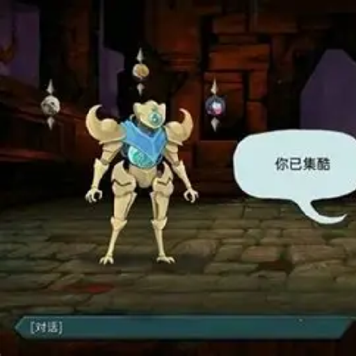

<div align="center">
  
</div>

# 杀戮尖塔一代角色 / Slay the Spire 1 Characters

把《杀戮尖塔 1》的三名原始角色 —— **铁甲战士 / Ironclad**、**静默猎手 / Silent**、**故障机器人 / Defect** —— 连同他们的一代卡池、遗物、事件、药水与力量，作为独立内容层移植进《杀戮尖塔 2》。

[](mod/Spire1.json)
[](https://store.steampowered.com/app/2868840/)
[](https://github.com/Alchyr/BaseLib-StS2/releases)
[](LICENSE)
[](https://store.steampowered.com/app/2868840/)

> **English**: The three original *Slay the Spire 1* characters — Ironclad, Silent and Defect — ported to *Slay the Spire 2* as additive characters, with their StS1 card pools, relics, events, powers and potions. Single runtime dependency: BaseLib 3.4.5+. Not affiliated with Mega Crit.

---

## 这是什么 / What is this

*《杀戮尖塔 2》的引擎里已经存在铁甲战士 / 静默猎手 / 故障机器人的同名卡牌与卡池，数值按二代重新平衡过。* 本模组不替换、也不隐藏它们，而是在角色选择界面**并列新增**三个独立角色（游戏内名称 `StS1 - 铁甲战士` / `StS1 - 静默猎手` / `StS1 - 故障机器人`），按**一代原版**的初始生命、初始卡组、初始遗物、卡池、遗物池、药水池与事件重新实现一遍。

卡牌数值按一代原版逐张对齐（费用、基础值、升级增量、关键字、目标、稀有度）。与二代已出货卡牌**逐字段一致**的条目直接复用二代卡；任何一项有差异的条目使用本模组自研的一代忠实实现，避免二代的平衡改动渗进一代层。

模组只依赖 BaseLib，与二代原生内容和社区幕组同时安装时互不替换。三名一代角色可以进入任意二代地牢，也可以和二代角色一起联机。模组自带的运行时开关允许你在一局里完全不使用它的任何内容，而无需卸载。

> **English**: StS2 already ships same-named cards and pools for these characters with rebalanced numbers. This mod does not replace them — it adds three separate characters (`StS1 - Ironclad` / `- Silent` / `- Defect`) that follow the *original* StS1 numbers, card pools, relics, events and potions. Cards whose numbers match the shipped StS2 card field-for-field are reused instead of duplicated; any drift keeps a faithful StS1 implementation.

---

## 特性 / Features

> 以下内容均可在仓库代码中逐项对应；括号内为源码位置。

### 三名可玩角色

| 角色 | 初始生命 | 初始卡组 | 初始遗物 | 核心机制 |
|---|---|---|---|---|
| 铁甲战士 / Ironclad | 80 | 5× 打击、4× 防御、1× 重击 | 燃血 / Burning Blood（战后回复 6 点生命） | 力量、消耗、以生命换输出 |
| 静默猎手 / Silent | 70 | 5× 打击、5× 防御、1× 中和、1× 生存者 | 蛇之戒指 / Ring of the Snake（开局多抽 2 张） | 毒素、小刀、弃牌堆流转 |
| 故障机器人 / Defect | 75 | 4× 打击、4× 防御、1× 电击、1× 双重释放 | 破裂核心 / Cracked Core（战斗开始时引导 1 个闪电充能球） | 充能球 / Orb（闪电 / 寒霜 / 黑暗）、集中 |

源码：`mod/Spire1Code/Character/{Ironclad,Silent,Defect}.cs`（角色本体与初始卡组）、`mod/Spire1/localization/{zhs,eng}/characters.json`（游戏内名称与描述）。

### 卡牌池 / Card pools

- **220 个具体卡牌类**（`mod/Spire1Code/Cards/` 共 222 个类文件，另 2 个是抽象基类）：覆盖一代的 基础牌 / 普通 / 罕见 / 稀有 / 状态 / 诅咒。
- **93 张二代卡直接复用**：与一代同名且逐字段一致的二代已出货卡牌，不再重复实现（`Character/SharedCardReuse.cs` 共 103 条注入，其中 10 条见下）。
- **10 张"漂移同名卡"**：二代改过稀有度或数值的条目（Bludgeon、Acrobatics、Predator、DarkEmbrace、Claw、Barrage、Flechettes、Chill、Darkness、Envenom）改用自研的一代忠实版，不让二代平衡污染一代层（`SharedCardReuse.RarityDriftTwins` / `FieldDriftTwins`）。
- **79 个同名类退役**：与二代同名同效果的自研类移入 `Spire1LegacyPool` —— 仍会注册，只为旧存档还能解析 `SPIRE1-*` id，**不会出现在任何奖励、商店或图鉴里**（上条那 10 个"漂移同名卡"是例外：它们由 `SharedCardReuse` 在运行期改注入角色池）；其余 **141 个**类直接归属可玩卡池（`Character/Spire1LegacyPool.cs`）。
- 每张角色牌加入对应角色的专属池；按引擎规则进入无色 / 事件奖励池。**不替换任何二代卡牌。**

> **计数口径**：以上为代码里可机械重数的**具体类**数量，不是类文件数量。复现：
> `grep -rhE '^public (sealed |partial )*class ' mod/Spire1Code/Cards | wc -l` → `220`；
> `grep -rhE '^\[Pool\(typeof\(Spire1LegacyPool\)\)\]' mod/Spire1Code/Cards | wc -l` → `79`；
> `grep -o 'typeof(Sts2Cards\.[A-Za-z]*' mod/Spire1Code/Character/SharedCardReuse.cs | wc -l` → `103`。

### 遗物 / Relics

24 件一代遗物（`mod/Spire1Code/Relics/`），包含三件初始遗物及其升级版（燃血 → 黑血、蛇之戒指 → 龙之戒指、破裂核心 → 注能核心），以及 Nilry's Codex、Enchiridion、Toolbox、Necronomicon、Girya、Kunai、Shuriken、Pen Nib、Mark of Pain、Magic Flower 等。数值按二代引擎语义适配，效果按一代原版实现。

> 计数：`grep -rhE '^public (sealed |partial )*class ' mod/Spire1Code/Relics | wc -l` → `24`（另有 1 个抽象基类 `Spire1Relic`）。

### 事件 / Events

6 个一代独有事件（`mod/Spire1Code/Events/`）：

| 类 | 游戏内名称（中 / 英） | 可遇到 |
|---|---|---|
| `Addict` | 流浪汉的恳求 / Pleading Vagrant | 是 |
| `BackToBasics` | 古老文字 / Ancient Writing | 是 |
| `DrugDealer` | 增益研究者 / Augmenter | 是 |
| `FountainOfCurseRemoval` | 神圣泉水 / The Divine Fountain | 是 |
| `NoteForYourself` | 留给自己的讯息 / A Note For Yourself | 是 |
| `SpireHeart` | 高塔之心 / Spire Heart | 否（未接入，见「已知问题」） |

默认**不注入**事件池，需在模组设置里打开（见下文「设置」）。其余一代事件由 [Acts from the Past](https://steamcommunity.com/sharedfiles/filedetails/?id=3746969593) 提供，本模组不重复实现。

### 药水与力量 / Potions & Powers

- **2 种药水**：爆炸药水 / Explosive Potion、恐惧药水 / Fear Potion（`mod/Spire1Code/Potions/`）。
- **60 个力量类**（`mod/Spire1Code/Powers/` 共 62 个类文件，含 2 个抽象基类）：覆盖一代的增益/减益，包含观者（Watcher）的架势（Calm / Wrath / Divinity）与真言（Mantra）基础设施 —— 这部分是给后续内容预留的运行时基础，当前没有观者角色。

### 本地化 / Localization

简体中文 + English 双语文案，覆盖卡牌、遗物、事件、力量、药水、角色、设置界面（`mod/Spire1/localization/{zhs,eng}/*.json`）。描述支持动态数值（`!D!` / `!B!` / `*关键字*` 由 BaseLib SimpleLoc 在加载期展开）。

### 设置 / Settings

`设置 → Mod 设置 → Spire1`，全部为运行时开关（`Config/Spire1Config.cs`）：

| 开关 | 作用 | 默认 |
|---|---|---|
| 一代内容 | 总开关，关闭后本模组全部内容停用 | 开 |
| 一代角色 | 在角色选择里显示三个一代角色 | 开 |
| 一代卡牌 / 遗物 / 药水 / 力量 | 分别控制各类内容注入与生效 | 开 |
| 注入一代事件到事件池 | 把上表事件注册进幕事件池 | **关** |
| 纯一代卡池 | 角色池不注入二代同名牌，全部用一代忠实实现填充 | 关 |
| 将内容登记进下一局 | 在建局时把当前内容状态快照进该局存档 | 开 |
| 联机忽略 mod 差异（清单级） | 握手时忽略双方 mod 清单差异强制放行（会削弱序列化安全，双方需相同构建） | **开** |
| 联机忽略 ModelID 哈希差异（哈希级） | 游戏版本相同但 ModelID 哈希不符时放行（会削弱序列化安全，双方需相同构建） | 关 |
| 地图跳过节点按钮 | 卡死在房间时的救援按钮（走原生投票管线） | 开 |

### 与 BaseLib 的关系

BaseLib 是**唯一**的运行时依赖（`mod/Spire1.json` → `dependencies: [{ "id": "BaseLib", "min_version": "3.4.5" }]`）。本模组使用它提供的自定义角色 / 卡池 / 遗物 / 药水 / 力量抽象、`SimpleLoc` 本地化展开、`ModConfigRegistry` 设置界面，以及内容注册钩子。没有 BaseLib 时模组不会加载；`RitsuLib`、`JmcModLib` 等其它框架**不是**依赖。

---

## 安装 / Installation

### 方式一：创意工坊（推荐）

1. 订阅 [杀戮尖塔一代角色](https://steamcommunity.com/sharedfiles/filedetails/?id=3799031900)（Workshop id `3799031900`）。
2. 订阅 [BaseLib](https://steamcommunity.com/sharedfiles/filedetails/?id=3737335127)（**必须**）。
3. 启动游戏，在 `设置 → Mod 设置` 中确认模组已加载。

### 方式二：手动安装

1. 下载发行包（或自行构建，见下节）。
2. 解压到游戏根目录的 `mods/` 下，最终结构必须是：

   ```
   Slay the Spire 2/
   └─ mods/
      ├─ BaseLib/          ← BaseLib.dll + BaseLib.pck + BaseLib.json
      └─ Spire1/
         ├─ Spire1.dll
         ├─ Spire1.pck
         └─ Spire1.json
   ```

3. **不要**同时保留两份 BaseLib（工坊版 + 手动版），否则会双加载报错。

### 依赖版本提示

`mod/Spire1.json` 要求 **BaseLib ≥ 3.4.5**，本仓库也按 3.4.5 编译。创意工坊的 BaseLib 更新经常落后于官方 GitHub：游戏更新后如果 BaseLib 报错或本模组加载失败，请从 [BaseLib GitHub Releases](https://github.com/Alchyr/BaseLib-StS2/releases) 取最新版，解压进 `mods/`，并**取消订阅工坊版 BaseLib**。

---

## 从源码构建 / Building from source

### 前置

- **.NET 9 SDK**（本项目目标框架 `net9.0`）
- 已安装的《杀戮尖塔 2》（构建需要引用游戏目录下的 `sts2.dll` 与 `0Harmony.dll`）
- 仅当需要产出 `.pck`：Godot 4.5.1 mono 导出器（`mod/Directory.Build.props:5` 的 `<GodotPath>`，默认值指向维护者机器的 `C:/megadot/...`，需按本机修改）

### 构建

```bash
git clone https://github.com/Twelve-eight/sts2-spire1.git
cd sts2-spire1

dotnet build mod/Spire1.csproj -c Release \
  -p:Sts2Path="C:/Program Files (x86)/Steam/steamapps/common/Slay the Spire 2" \
  -p:CopyToModsFolderOnBuild=false
```

- `Sts2Path` 必须指向**游戏根目录**（其下应有 `data_sts2_windows_x86_64/`，内含 `sts2.dll`、`0Harmony.dll`）。缺失时 `CheckDependencyPaths` 会直接失败：`Slay the Spire 2 data not found at path '...'`。
  也可以在 `mod/Directory.Build.props` 里取消注释 `<Sts2Path>` 固定下来；自动探测顺序为 `Sts2TestPath` → 维护者本机的本地副本 → 仓库内的测试客户端副本，**不会**回落到 Steam 安装目录。
- `-p:CopyToModsFolderOnBuild=false` 表示"只编译、不写进游戏目录"。
- 产物：`mod/.godot/mono/temp/bin/Release/Spire1.dll`。

### 产出可用的 mod 目录

```bash
mkdir -p "<StS2>/mods/Spire1"
cp mod/.godot/mono/temp/bin/Release/Spire1.dll "<StS2>/mods/Spire1/"
cp mod/Spire1.json                             "<StS2>/mods/Spire1/"
# 如果手上这次构建/发行包带有 Spire1.pck，一并复制：
cp "<含 Spire1.pck 的目录>/Spire1.pck"          "<StS2>/mods/Spire1/"
```

`.pck` 由 Godot 导出（`dotnet publish` + `GodotPath`）或由 `BSchneppe.StS2.PckPacker` 生成；`CopyToModsFolderOnBuild=false` 的编译路径**不生成** `.pck`。

> **一条维护者限制，外部构建前请先读**
> `AssertModsPathIdentity` 目标只允许 `mod/Spire1.csproj` 中 `ModsPath` 白名单内的部署根目录，用于防止构建误写进真实的 Steam 安装。落在白名单外会以 `MODSPATH-GUARD-DENY` 失败 —— 这是**预期行为**，用 `-p:CopyToModsFolderOnBuild=false` 或把游戏放在白名单路径即可。

---

## 兼容性与已知问题 / Compatibility & known issues

- **BaseLib 版本漂移**：见「依赖版本提示」。工坊 BaseLib 落后时，本模组可能无法加载。
- **高塔之心事件不可遇到**：`SpireHeart` 以 `autoAdd: false` 构造，且仓库中没有任何触发点。它需要一代的钥匙/结局流程，二代没有对应 API。因此实际可遇到的一代独有事件是 **5 个**（不是 6 个）。
- **观者（Watcher）与一代地牢已移除**：早期测试版包含观者角色与自建的一代地牢/怪物，现版本已整体删除。旧存档里指向这些内容的引用会被引擎降级为占位卡（不会崩溃），其余内容不受影响；`mod/Spire1Code/Powers` 中仍保留架势/真言的基础设施，但没有观者角色可玩。
- **退役卡兜底**：v1.2.5 修复了 79 张退役 `SPIRE1-*` 卡在取 `Pool` 时抛 `InvalidProgramException` 导致的联机校验和分叉；现在会回落到铁甲池。走到兜底时，该卡的卡框与图标会按铁甲池渲染 —— 这是兜底而非根因修复。
- **联机**：需要双方安装**相同构建**。`联机忽略 mod 差异` / `忽略 ModelID 哈希差异` 两个开关只是容错，打开会削弱序列化安全，哈希不符时强制放行可能造成失同步；真实游戏版本不符仍会被拦截。
- **纯一代卡池模式**：开启后角色池不再注入二代同名牌，缺失由自研实现补齐；奖励类事件要求"N 张不重复"时，抽牌数量会被钳制到池内实际可行数。
- **事件默认关闭**：一代事件默认不进入事件池，需要在设置里显式打开。

---

## 开发 / Development

```
sts2-spire1/
├─ mod/                         Godot 4.5.1 + .NET 9 的模组工程（Spire1.csproj / Spire1.json）
│  ├─ Spire1Code/               C# 源码
│  │  ├─ Character/             三个角色、卡池/遗物池/药水池、SharedCardReuse
│  │  ├─ Cards/  Relics/  Powers/  Potions/  Events/
│  │  ├─ Patches/               Harmony 补丁（内容门控、联机、存档保护）
│  │  ├─ Interop/               第三方 mod 反射桥（AFTP / Forms / Auto-Anthonyology）
│  │  ├─ Config/                Spire1Config 运行时开关、CharacterGate
│  │  ├─ Run/                   按局内容快照
│  │  └─ Diagnostics/           卡池普查（诊断用，默认关闭）
│  └─ Spire1/                   资源与本地化（images/、localization/{zhs,eng}/）
├─ docs/                        公开文档（BaseLib API 参考、发布门禁、打包契约）
├─ tools/                       审计与发布工具（卡牌保真度审计、本地化标记检查、发布门、探针）
├─ workshop/                    创意工坊描述、封面、上传配置（workshop_upload.vdf）
├─ research/                    参考资料（引擎 API 索引、BaseLib 源码、一代数据）
├─ DEVELOP.md                   设计目标、契约与里程碑（先读这个）
└─ DEVLOG.md                    内部开发日志（不随仓库分发）
```

约定：内容类一律继承 `Spire1Card` / `Spire1Relic` / `Spire1Potion` / `Spire1Event`，通过 BaseLib 的池标记自动注册；ID 形如 `SPIRE1-<CLASS>`；每个内容类都必须在 `localization/{eng,zhs}` 里有对应条目。详细契约见 [`DEVELOP.md`](DEVELOP.md)。

已构建的第三方互操作（全部为可选、缺失即自动禁用，不产生硬依赖）：

- **Acts from the Past**（Workshop `3746969593`）：特效节点生命周期兼容层（`Interop/AftpEffectLifecycleCompat.cs`）。
- **Auto-Anthonyology**（Workshop `3786611028`）：让其"每局随机卡池"覆盖三个一代角色（`Interop/AutoAnthonyCompatBridge.cs`）。
- **Forms**：架势系统的可选反射桥（`Interop/FormsCompatibilityBridge.cs`）。

---

## 贡献与反馈 / Contributing & feedback

- **Bug 报告 / 功能建议**：[GitHub Issues](https://github.com/Twelve-eight/sts2-spire1/issues)。
- 报告加载失败或崩溃时，请附上：模组版本（`mod/Spire1.json` 的 `version`）、游戏版本、BaseLib 版本、已安装的其它 mod 列表，以及游戏日志。
- 改代码前建议先读 `DEVELOP.md` 的「Contracts」一节：内容类必须带本地化条目（否则构建期分析器 `STS001` 会失败），效果必须走 `*Cmd` / `CommonActions`，不要直接改状态。
- 提交前请各自本地构建（`dotnet build`）并跑一遍 `tools/audit-card-fidelity.mjs` 与 `tools/check-loc-markup.mjs`。

---

## 致谢与声明 / Credits & disclaimer

- **Mega Crit**：《Slay the Spire》《Slay the Spire 2》及其角色、卡牌、遗物、图标等美术资源的版权归 **Mega Crit, LLC** 所有。本模组是非官方粉丝作品，与 Mega Crit 无任何隶属或背书关系。
- **美术资源来源**：卡牌立绘、遗物图标、力量图标、遭遇战图标（`mod/Spire1/images/{card_portraits,relics,powers,run_history}`）取自《杀戮尖塔 1》的游戏资源，仅随这个**非商业**的粉丝移植分发。代码与美术的授权是两件不同的事：仓库代码见 [`LICENSE`](LICENSE)，一代美术不在此许可范围内。
- **[BaseLib](https://github.com/Alchyr/BaseLib-StS2)**（Alchyr）：本模组唯一的运行时依赖，没有它就没有这套内容抽象。
- **[Acts from the Past](https://steamcommunity.com/sharedfiles/filedetails/?id=3746969593)**：提供一代幕组与其余一代事件，与本模组互补而非重复。
- **[Auto-Anthonyology](https://steamcommunity.com/sharedfiles/filedetails/?id=3786611028)**：每局随机卡池玩法的来源，本模组为其提供可选的桥接层。
- 数值与文案依据：一代游戏本体的字节码与公开 Wiki 资料；卡牌保真度由 `tools/audit-card-fidelity.mjs` 对照审计。

---

## License

- **代码**：以仓库根目录的 [`LICENSE`](LICENSE) 为准。本 README 不重复声明许可条款；若该文件缺失，请以 Issue 询问维护者后再使用。
- **游戏美术资源**：不属于上述代码许可范围，版权归 Mega Crit, LLC，仅作非商业粉丝移植用途分发。
- **第三方依赖**：BaseLib 遵循其自身许可证。

> **English**: Source code is licensed under the terms in [`LICENSE`](LICENSE). Art assets originate from *Slay the Spire* and remain © Mega Crit, LLC; they are redistributed only as part of this non-commercial fan port and are not covered by the code license.

---

## English summary

**What it is.** Slay the Spire 2 already ships same-named cards and pools for the Ironclad, Silent and Defect, with rebalanced numbers. This mod adds three *separate* characters (`StS1 - Ironclad` / `- Silent` / `- Defect`) built on the original StS1 numbers, card pools, relics, events, potions and powers. Vanilla StS2 content is never replaced or hidden.

**Content.** 3 characters (80/70/75 HP with their StS1 starter decks and starter relics), 220 card classes, 93 shipped StS2 cards reused where field-for-field identical, 24 relics, 6 events (5 reachable), 2 potions, 60 power classes, full zh/en localization, and per-category runtime toggles in *Settings → Mod Settings*.

**Requirements.** Slay the Spire 2 `0.111.0+` and BaseLib `3.4.5+` (the only runtime dependency). If the Workshop BaseLib lags behind a game update, install the latest release from [BaseLib's GitHub](https://github.com/Alchyr/BaseLib-StS2/releases) and unsubscribe from the Workshop copy.

**Install.** Subscribe on the [Workshop](https://steamcommunity.com/sharedfiles/filedetails/?id=3799031900), or drop `Spire1.dll`, `Spire1.pck` and `Spire1.json` into `Slay the Spire 2/mods/Spire1/`.

**Build.**

```bash
dotnet build mod/Spire1.csproj -c Release \
  -p:Sts2Path="<path to Slay the Spire 2>" \
  -p:CopyToModsFolderOnBuild=false
```

Requires the .NET 9 SDK; the output is `mod/.godot/mono/temp/bin/Release/Spire1.dll`. See [Building from source](#从源码构建--building-from-source) for the ModsPath allowlist caveat.

**Not affiliated with Mega Crit.** *Slay the Spire* and *Slay the Spire 2* are trademarks of Mega Crit, LLC. This is a non-commercial fan project.
